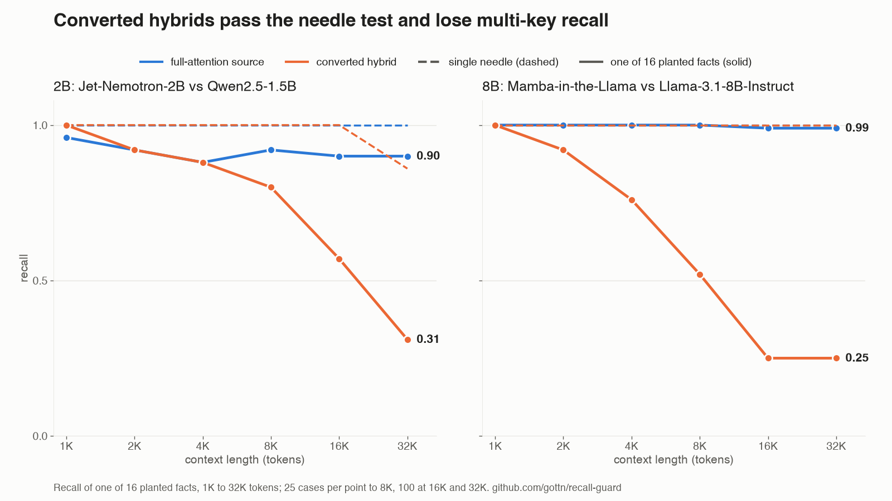
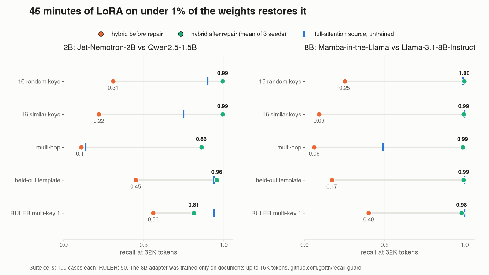

# recall-guard

[](LICENSE)
[](pyproject.toml)

A recall-regression harness for long-context language models, and a post-hoc repair for converted hybrids.

<picture>
  <source media="(prefers-color-scheme: dark)" srcset="docs/img/explainer-dark.png">
  
</picture>

A converted hybrid is a pretrained transformer whose attention layers were mostly replaced by linear-attention or
state-space layers. Such models pass the single-needle test and still fail to recall one of sixteen planted facts at
32K tokens. A LoRA adapter on under 1% of the weights, trained for 45 minutes on synthetic many-fact documents, brings
recall back to the source model's level. This repository holds the harness that measures it, the repair that restores
it, every raw completion behind the paper, and the scripts that turn those completions into the paper's tables and
figures.

Paper: *Multi-Key Recall in Converted Hybrid Language Models: A Training Deficit, Not a Capacity Limit*
(Musaab Ahmed Mahjoub, Aalborg University, 2026; arXiv submission pending). Source in `paper/`. The limits are in its
Sections 5 and 6: UUID-style values and multi-answer questions are only partly repaired, and at 2B a gap to the
identically trained control remains on RULER.

## Results in two figures

<picture>
  <source media="(prefers-color-scheme: dark)" srcset="docs/img/hero-dark.png">
  
</picture>

<picture>
  <source media="(prefers-color-scheme: dark)" srcset="docs/img/repair-dark.png">
  
</picture>

## Layout

| path | contents |
|---|---|
| `recall_guard/` | the package. Pure core: `tasks.py` (one generator per stressor), `filler.py`, `suite.py` (tasks x lengths x cases, sized under a reference tokenizer), `score.py`, `aggregate.py`, `train_data.py` (repair documents), `ruler.py` (RULER records as cases), `types.py` |
| `recall_guard/backends/` | the only effectful code: `hf.py` (HuggingFace completion backend), `lora.py` (dependency-free LoRA), `train.py` (repair training), `mc.py` (ARC-Easy, HellaSwag), `restore.py` (training-free query/key copy), `loaders.py` with `mil.py` and `lolcats.py` (converted 8B hybrids that `AutoModel` cannot build; the LoLCATs loader is experimental and not used in the paper) |
| `cli.py` | `generate`, `run`, `train`, `bench`, `ppl`, `import-ruler`, `report` |
| `exp01_step1/` | Experiment 1: do the stressors separate a hybrid from its source where the needle does not? |
| `exp02_repair/` | Experiment 2: the first LoRA repair at 2B |
| `exp03_robust/` | Experiment 3: robustness, RULER, the 8B pair, the recipe sweep, the training-free baseline, and the scoring audits (`ruler_budget.py`, `drift.py`) |
| `paper/` | LaTeX source; `fig/make_figures.py` and `fig/make_tables.py` build every figure and table from `exp*/results/raw`; `fig/make_readme.py` and `fig/make_explainer.py` build the images above |
| `docs/` | the prior-art check, the pre-registered robustness plan, and the README images |
| `infra/` | cluster setup, the job-submission wrapper and the Slurm scripts (AAU AI Cloud, singularity) |
| `STATE.md` | the lab notebook: status, run directories, job ids, decisions and traps, in the order they happened |

Each experiment folder has a `RESULTS.md` that leads with the verdict, a `run_all.sh` whose header holds the cluster
commands, and `results/raw/` with every completion as JSONL. Suites (the prompts) are not committed; they regenerate
byte-identically from the recorded commit, seed and reference tokenizer (`*.prov.json`).

## Install and test

```
uv venv --python 3.12 .venv && VIRTUAL_ENV=.venv uv pip install -e '.[dev]'
git config core.hooksPath .githooks    # commit-message format, see STYLE.md
./check.sh                              # ruff, purity grep, tests, hook check
```

The core runs without a model or a GPU. Running models needs `uv pip install -e '.[run]'` and, for the converted
hybrids, the environments pinned in `infra/cluster/requirements-*.txt` (Jet-Nemotron needs its own transformers and
flash-linear-attention fork; the 8B hybrids need the Mamba-in-the-Llama sources).

## Use the harness

```
python -m recall_guard.cli generate --out suite.jsonl --tokenizer Qwen/Qwen2.5-1.5B --cases 25
python -m recall_guard.cli run --suite suite.jsonl --model Qwen/Qwen2.5-1.5B --out qwen.jsonl
python -m recall_guard.cli run --suite suite.jsonl --model jet-ai/Jet-Nemotron-2B --trust-remote-code --out jet.jsonl
python -m recall_guard.cli report --results qwen.jsonl jet.jsonl --pair jet-ai/Jet-Nemotron-2B=Qwen/Qwen2.5-1.5B
```

Tasks: `needle` (the control), `many_random` and `many_similar` (sixteen keys), `updated` (overwritten facts),
`multihop` (two-hop chains) and `heldout_many` (a second fact template, never used for training). Lengths run from
1K to 32K tokens, sized under one reference tokenizer so every model sees byte-identical prompts. A case is recalled
when the planted six-digit code appears on the first line of the completion. The report lists recall by length and the
first length at which a stressor separates a pair while the needle does not.

Repair, collateral checks and RULER:

```
python -m recall_guard.cli train --model jet-ai/Jet-Nemotron-2B --trust-remote-code --out adapter/ --n-docs 300 --lr 5e-5
python -m recall_guard.cli run   --suite suite.jsonl --model jet-ai/Jet-Nemotron-2B --trust-remote-code --adapter adapter/ --out jet-repaired.jsonl
python -m recall_guard.cli bench --model jet-ai/Jet-Nemotron-2B --trust-remote-code --adapter adapter/ --out bench.json
python -m recall_guard.cli ppl   --model jet-ai/Jet-Nemotron-2B --trust-remote-code --adapter adapter/ --text book.txt --out bpb.json
python -m recall_guard.cli import-ruler --dir <RULER generator output> --out-dir ruler/
```

`train` writes `adapter.pt` and `adapter_config.json`; `run` merges the adapter into the weights (`--adapter-mode
attach` keeps it unmerged). `bench` scores ARC-Easy and HellaSwag by log-likelihood; `ppl` measures bits per byte on
16K windows of a long text; `import-ruler` turns NVIDIA RULER's generator output into cases for the same runner.

## Reproduce the paper

```
exp01_step1/run_all.sh report && exp02_repair/run_all.sh report && exp03_robust/run_all.sh report
.venv/bin/python exp03_robust/ruler_budget.py            # generation-budget and scoring audits
cd paper && make figures && make tables && make          # figures, the five tables, main.pdf (needs latexmk)
cd paper && make readme                                  # the README images, light and dark
```

The cluster jobs that produced each run are listed in the `run_all.sh` headers and in `STATE.md`; they start only
through `infra/cluster/submit.sh`, which records the commit and writes outputs outside the repository.

## Conventions

`STYLE.md`: pure functions with effects only at the edges, explicit seeds, suites and results as dated artifacts,
Conventional Commits with the measured effect in the subject, `./check.sh` before every commit.

## License

MIT, see `LICENSE`. Model outputs in `results/raw` were produced with Qwen2.5, Jet-Nemotron, Llama 3.1 and
Mamba-in-the-Llama checkpoints under their own licenses.
