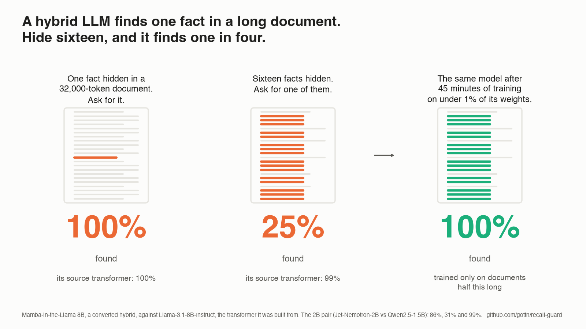

# recall-guard

[](LICENSE)
[](pyproject.toml)

A recall-regression harness for long-context language models, and a post-hoc repair for converted hybrids.

<picture>
  <source media="(prefers-color-scheme: dark)" srcset="docs/img/explainer-dark.png">
  
</picture>

A converted hybrid is a pretrained transformer whose attention layers were mostly replaced by linear-attention or
state-space layers. Such models pass the single-needle test and still fail to recall one of sixteen planted facts at
32K tokens. A LoRA adapter on under 1% of the weights, trained for 45 minutes on synthetic many-fact documents, brings
recall back to the source model's level.

Paper: *Multi-Key Recall in Converted Hybrid Language Models: A Training Deficit, Not a Capacity Limit*
(Musaab Ahmed Mahjoub, Aalborg University, 2026),
[PDF](https://github.com/gottn/recall-guard/releases/download/v1.0/recall-guard-paper.pdf). Its Sections 5 and 6 state
the limits: UUID-style values and multi-answer questions are only partly repaired, and at 2B a gap to the identically
trained control remains on RULER.

## Install

```
uv venv --python 3.12 .venv && VIRTUAL_ENV=.venv uv pip install -e '.[dev]'
./check.sh
```

Running models needs `uv pip install -e '.[run]'`; the converted hybrids need the environments pinned in
`infra/cluster/requirements-*.txt`.

## Run

```
python -m recall_guard.cli generate --out suite.jsonl --tokenizer Qwen/Qwen2.5-1.5B --cases 25
python -m recall_guard.cli run --suite suite.jsonl --model Qwen/Qwen2.5-1.5B --out qwen.jsonl
python -m recall_guard.cli run --suite suite.jsonl --model jet-ai/Jet-Nemotron-2B --trust-remote-code --out jet.jsonl
python -m recall_guard.cli report --results qwen.jsonl jet.jsonl --pair jet-ai/Jet-Nemotron-2B=Qwen/Qwen2.5-1.5B
```

Tasks: `needle`, `many_random`, `many_similar`, `updated`, `multihop`, `heldout_many`, at 1K to 32K tokens, sized
under one reference tokenizer so every model sees byte-identical prompts. A case is recalled when the planted six-digit
code appears on the first line of the completion.

Repair:

```
python -m recall_guard.cli train --model jet-ai/Jet-Nemotron-2B --trust-remote-code --out adapter/ --n-docs 300 --lr 5e-5
python -m recall_guard.cli run   --suite suite.jsonl --model jet-ai/Jet-Nemotron-2B --trust-remote-code --adapter adapter/ --out jet-repaired.jsonl
```

`bench` (ARC-Easy, HellaSwag), `ppl` (bits per byte on long text) and `import-ruler` (RULER cases) are documented in
`python -m recall_guard.cli -h`.

## Results

`exp01_step1/`, `exp02_repair/` and `exp03_robust/` each hold a `RESULTS.md` and every raw completion under
`results/raw/`; `STATE.md` is the lab notebook. `exp*/run_all.sh report` regenerates the tables and
`cd paper && make figures && make tables && make` rebuilds the paper from them.

## Cite

```bibtex
@techreport{mahjoub2026recall,
  title       = {Multi-Key Recall in Converted Hybrid Language Models: A Training Deficit, Not a Capacity Limit},
  author      = {Mahjoub, Musaab Ahmed},
  institution = {Aalborg University},
  year        = {2026},
  url         = {https://github.com/gottn/recall-guard}
}
```

## License

MIT. Model outputs in `results/raw` were produced with Qwen2.5, Jet-Nemotron, Llama 3.1 and Mamba-in-the-Llama
checkpoints under their own licenses.
